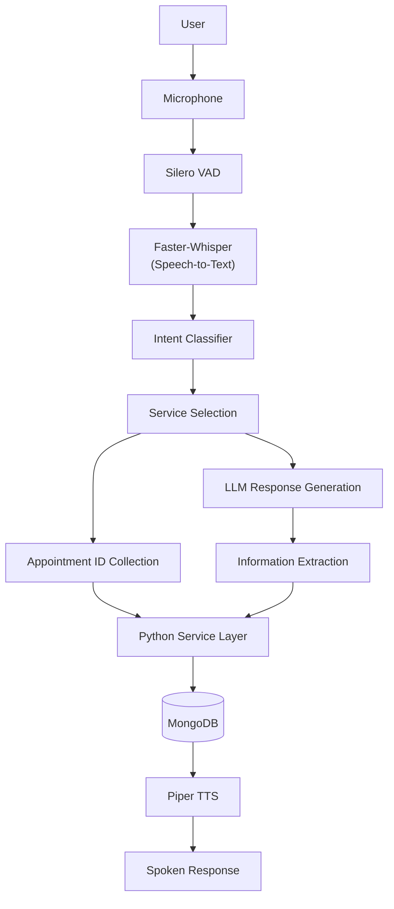

# Hospital Receptionist – AI Voice Agent

An AI-powered hospital receptionist that handles appointment-related requests through voice interaction. It uses speech recognition, intent classification, LLM-based information extraction, MongoDB, and offline text-to-speech.

## Features

- **Voice Interaction:** Accepts voice input through a microphone.
- **Speech-to-Text:** Converts speech into text using Faster-Whisper.
- **Voice Activity Detection:** Uses Silero VAD to detect when the caller starts and stops speaking.
- **Intent Classification:** Identifies the type of appointment request.
- **Information Extraction:** Uses an LLM to collect and extract required patient information.
- **Appointment Booking:** Stores new appointments in MongoDB.
- **Appointment Cancellation:** Cancels existing appointments using their appointment ID.
- **Appointment Search:** Retrieves appointment information.
- **Appointment Updates:** Updates existing appointment details.
- **Offline Text-to-Speech:** Uses Piper to generate spoken responses.


## Workflow Architecture




## Tech Stack

| Component | Technology |
|---|---|
| Programming Language | Python |
| Speech-to-Text | Faster-Whisper |
| Voice Activity Detection | Silero VAD |
| Intent Classification | LLM |
| Response Generation | Groq API |
| Text-to-Speech | Piper |
| Database | MongoDB |
| Containerization | Docker |
| Audio Processing | SoundDevice, NumPy |
| Data Validation | Python / Pydantic |

## Project Structure

```text
Hospital-Receptionist/
│
├── voice_agent.py
├── response_generator.py
├── router.py
├── tools.py
├── database.py
│
├── docker-compose.yaml
├── requirements.txt
├── .env.example
├── .gitignore
│
├── content_memory.json
├── ideal_memory.json
│
└── en_US-lessac-medium.onnx
    en_US-lessac-medium.onnx.json
```

**Note:** The `.env`, memory JSON files, audio recordings, virtual environment, and model files should not be committed to GitHub.

## Prerequisites

- Python 3.10 or later
- Docker Desktop
- Git
- Microphone and speakers
- Groq API key
- Piper voice model

## Installation and Setup

### 1. Clone the repository

```bash
git clone <YOUR_REPOSITORY_URL>
cd Hospital-Receptionist
```

### 2. Create a virtual environment

```bash
python -m venv .venv
```

Activate it:

**Windows:**

```powershell
.venv\Scripts\activate
```

### 3. Install dependencies

```bash
pip install -r requirements.txt
```

### 4. Configure environment variables

Create a `.env` file in the project root.

```env
GROQ_API_KEY=your_groq_api_key

MONGODB_URI=mongodb://localhost:27017/
MONGODB_DATABASE=hospital_db
```

Replace the placeholder API key with your actual Groq API key.

### 5. Configure Piper TTS

Download a compatible Piper voice model and its corresponding JSON configuration file.

Place both files in the project root:

```text
en_US-lessac-medium.onnx
en_US-lessac-medium.onnx.json
```

### 6. Start MongoDB using Docker

Run:

```bash
docker compose up -d
```

Verify the container:

```bash
docker ps
```

Test the MongoDB connection:

```bash
docker exec hospital-mongodb mongosh --eval "db.adminCommand('ping')"
```

### 7. Run the application

```bash
python voice_agent.py
```

## Appointment Services

The receptionist currently supports four primary services:

| Service | Description |
|---|---|
| Book Appointment | Collects patient details and creates an appointment. |
| Cancel Appointment | Accepts an appointment ID and cancels the appointment. |
| Update Appointment | Accepts an appointment ID and updates appointment details. |
| Search Appointment | Retrieves an existing appointment using its ID. |

Appointment IDs follow this format:

```text
APT-A1B2C3D4E5
```

## Docker Commands

| Operation | Command |
|---|---|
| Start MongoDB | `docker compose up -d` |
| Stop MongoDB | `docker compose stop` |
| Restart MongoDB | `docker compose restart` |
| View logs | `docker compose logs -f` |
| Stop and remove container | `docker compose down` |

MongoDB data is persisted using a Docker named volume.

## Future Improvements

- Add patient identity verification.
- Implement appointment slot availability checking.
- Add explicit confirmation before booking, updating, or cancelling appointments.
- Support multiple concurrent callers.
- Improve conversation context and session management.
- Add multilingual speech recognition and synthesis.
- Implement robust error handling and logging.
- Add automated testing and API integration.

## Security Considerations

This project is currently intended for learning and development.

- Do not commit API keys or database credentials.
- Do not use real patient information in an unsecured development environment.
- Implement authentication and authorization before handling actual patient records.
- Validate all extracted information before database operations.

## License

This project is intended for educational and development purposes.